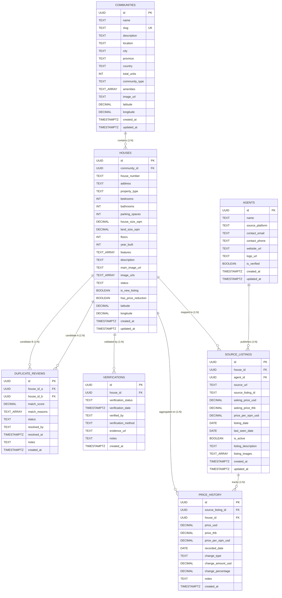

# Origins Atlas — Technical Architecture & Database Specification
**Document Version:** 1.0.0  
**Target Audience:** Independent Technical Architecture Reviewers & Engineering Stakeholders  
**Scope:** Current Staging Prototype (Milestones 1 & 2)

---

## 1. Executive Summary

Origins Atlas is a specialized luxury real estate intelligence platform designed to serve as the **authoritative single source of truth** for master-planned communities and high-end residential developments in Southeast Asia, beginning with Bangkok, Thailand.

In emerging and high-growth property markets across Southeast Asia, property data is notoriously fragmented. Multiple independent agencies, aggregators, and freelance brokers re-list the identical physical property across portals (Hipflat, DDproperty, FazWaz, DotProperty) with disparate price points, inconsistent descriptions, inaccurate coordinates, and stale availability.

Origins Atlas solves this fundamental market failure through an architectural paradigm centered on **Canonical Physical Entities**:
- **Communities** define the master-planned real estate development.
- **Houses** represent unique, permanent physical structures in the physical world (identified by plot, cadastral boundaries, and house numbers).
- **Source Listings** capture ephemeral broker listings across competing agencies, mapping multiple independent agency offerings back to one physical house.
- **Price History** maintains an immutable audit trail of price changes across agencies and canonical properties.
- **Duplicate Reviews** and **Verifications** ensure data integrity through algorithmic heuristics and verifiable ground truth.

---

## 2. Visual Entity-Relationship Diagram (ERD)



---

## 3. Database Schema & Data Dictionary

The database is built on **PostgreSQL 15+** managed via **Supabase**. All primary keys utilize standard UUIDv4 types (`uuid-ossp`).

### 3.1. Tables Overview

| Table Name | Description | Key Constraints & Indexes |
|---|---|---|
| `communities` | Master residential developments / gated projects. | `PRIMARY KEY (id)`, `UNIQUE(slug)`. |
| `houses` | The canonical physical real estate units. | `PRIMARY KEY (id)`, `FOREIGN KEY (community_id) ON DELETE CASCADE`, `UNIQUE(community_id, house_number)`, Indexes on `community_id`, `status`. |
| `agents` | Brokers, real estate agencies, and scraping sources. | `PRIMARY KEY (id)`. |
| `source_listings` | Broker-published listing instances across platforms. | `PRIMARY KEY (id)`, `FOREIGN KEY (house_id) ON DELETE CASCADE`, `FOREIGN KEY (agent_id) ON DELETE CASCADE`, Indexes on `house_id`, `agent_id`, `is_active`. |
| `price_history` | Time-series log of price adjustments. | `PRIMARY KEY (id)`, `FOREIGN KEY (source_listing_id) ON DELETE CASCADE`, `FOREIGN KEY (house_id) ON DELETE CASCADE`, Indexes on `source_listing_id`, `house_id`, `recorded_date`. |
| `verifications` | Audit records verifying house details, titles, and site visits. | `PRIMARY KEY (id)`, `FOREIGN KEY (house_id) ON DELETE CASCADE`, Index on `house_id`. |
| `duplicate_reviews` | Queue for suspected duplicate listings awaiting resolution. | `PRIMARY KEY (id)`, `FOREIGN KEY (house_id_a) ON DELETE CASCADE`, `FOREIGN KEY (house_id_b) ON DELETE CASCADE`, `UNIQUE(house_id_a, house_id_b)`, `CHECK (house_id_a != house_id_b)`. |

### 3.2. Automated Triggers & Maintenance
To prevent manual drift in timestamps, an automated PostgreSQL trigger (`update_updated_at_column()`) is attached to all mutable tables (`communities`, `houses`, `agents`, `source_listings`):

```sql
CREATE OR REPLACE FUNCTION update_updated_at_column()
RETURNS TRIGGER AS $$
BEGIN
  NEW.updated_at = NOW();
  RETURN NEW;
END;
$$ language 'plpgsql';
```

### 3.3. Security & Access Model (RLS)
The database enforces **Row Level Security (RLS)**:
- **Public (Anon/Authenticated):** Read access (`SELECT`) is granted across all public tables (`communities`, `houses`, `agents`, `source_listings`, `price_history`, `verifications`, `duplicate_reviews`).
- **Prototype Admin Layer:** Prototype write operations (`INSERT`, `UPDATE`, `DELETE`) are accessible through the web administration interface, which is gated by a secure Edge Proxy authentication layer.

---

## 4. Key Architectural Patterns

### 4.1. "One Physical House, Many Broker Listings"
In conventional real estate portals, each broker's listing is treated as an independent listing row. When 4 brokers list the same villa in Nirvana Absolute Bangna, the user sees 4 repetitive cards with conflicting details.

In Origins Atlas:
1. `houses` represents the immutable physical unit (e.g. Unit `88/12`).
2. Multiple brokers (`108Siam`, `PropertyScout`, etc.) each have an entry in `source_listings` pointing to that same `house_id`.
3. The public UI surfaces the consolidated canonical house, displaying:
   - Lowest current asking price among verified brokers.
   - Comprehensive broker comparison table showing who has listed it, their asking price, and original listing links.
   - Complete price history revealing if any broker recently discounted the asking price.

### 4.2. Immutable Price Tracking
Whenever a source listing is refreshed or edited:
- If `asking_price_usd` differs from the latest record, a new row is appended to `price_history`.
- `change_type` classifies the event (`initial`, `increase`, `decrease`, `no_change`).
- `change_amount_usd` and `change_percentage` are computed.
- The parent canonical `houses` record updates `has_price_reduction = true` if any active listing dropped in price.

### 4.3. Duplicate Detection & Reconciliation Engine
The `duplicate_reviews` table maintains potential duplicates detected via matching heuristics:
- Matching community (`community_id`).
- Identical or near-identical living area (`house_size_sqm` ± 5%).
- Identical bedroom and bathroom count.
- Closely clustered asking prices.
Admins can review candidate pairs side-by-side in `/admin/duplicates` and mark them as `confirmed_duplicate` (triggering an association merge) or `not_duplicate`.

---

## 5. Technology Stack & Implementation

```
┌────────────────────────────────────────────────────────┐
│                   Next.js 16 (App Router)              │
│       React 19 Server & Client Components + Turbopack   │
└──────────────────────────┬─────────────────────────────┘
                           │
             ┌─────────────┴─────────────┐
             ▼                           ▼
┌─────────────────────────┐ ┌─────────────────────────┐
│     Public Portal       │ │       Admin CMS         │
│  - Community Directory  │ │  - Edge Proxy Auth      │
│  - Canonical Explorer   │ │  - Web Crypto HMAC      │
│  - Price History Charts │ │  - Full CRUD Modals     │
│  - Responsive Map View  │ │  - Deduplication Queue  │
└────────────┬────────────┘ └────────────┬────────────┘
             │                           │
             └─────────────┬─────────────┘
                           ▼
┌────────────────────────────────────────────────────────┐
│            Supabase / PostgreSQL 15+ Engine            │
│  - Relational Schema with Foreign Key Cascades         │
│  - PostgreSQL Full-Text & Geospatial Indices           │
│  - Automated PL/pgSQL Timestamp Triggers               │
│  - Row Level Security (RLS) Enablement                 │
└────────────────────────────────────────────────────────┘
```

- **Framework:** Next.js 16.3.6 (Turbopack, TypeScript, React 19).
- **Styling Architecture:** Custom luxury design system (`globals.css`) with obsidian/gold themes, glassmorphism, responsive navigation, and mobile drawer views.
- **Database:** Supabase PostgreSQL 15+.
- **Authentication:** Stateless, high-performance HMAC-SHA256 session token system built on the native Web Crypto API (`src/lib/auth.ts`), validated at the edge by Next.js Proxy Middleware (`src/proxy.ts`).

---

## 6. Reviewer Test Credentials & Verification Guide

The reviewer has read-only architectural review scope and does **not** need Supabase master database credentials. The staging environment provides a fully interactive administrator interface to inspect, add, and edit records.

### 6.1. Staging Admin Credentials

| Parameter | Value |
|---|---|
| **Admin Login URL** | `https://[your-staging-url]/admin/login` (or `http://localhost:3000/admin/login`) |
| **Email** | `admin@originsatlas.com` |
| **Password** | `OriginsAtlas2026!` |
| **Session Lifetime** | 7 Days (Stateless `origins_admin_session` HttpOnly cookie) |

*A one-click "Fill Demo Credentials" button is also provided directly on the login screen for convenience.*

### 6.2. Recommended Workflows for Reviewer Verification

1. **Dashboard Overview (`/admin`):**
   - Review top-level statistics (Total Communities, Canonical Houses, Active Source Listings, Verified Agents, Pending Duplicates).
   - Inspect quick-access cards and system status indicators.

2. **Communities Workflow (`/admin/communities`):**
   - View existing community (*Nirvana Absolute Bangna*).
   - Test the **"Add Community"** modal (`/admin/communities/new`) to observe validation, auto-slug generation, and array handling for amenities.
   - Inspect edit form (`/admin/communities/[id]/edit`).

3. **Canonical Houses Workflow (`/admin/houses`):**
   - Inspect the 6 canonical house units. Note the status flags (`active`, `pending_review`).
   - Test filtering by Community and Status.
   - Test the **"Add House"** workflow (`/admin/houses/new`) to see how physical properties are created with specifications, coordinates, and photo galleries.

4. **Agents & Brokers Directory (`/admin/agents`):**
   - Review registered agency entities (`108Siam`, `PropertyScout`, `Connex Property`, `Agentplus`).
   - Test adding a new broker source.

5. **Source Listings & Cross-Broker Mappings (`/admin/listings`):**
   - Inspect how external listings map between specific `houses` and `agents`.
   - Observe the multi-currency storage (`asking_price_usd` and `asking_price_thb`).

6. **Duplicate Resolution Queue (`/admin/duplicates`):**
   - Review the candidate duplicate pair flagged between Unit `88/12` and Unit `88/35`.
   - Inspect match score (0.78) and matching heuristic tags (`same_community`, `matching_price_point`, `identical_bedroom_count`).

---

## 7. Migration Files & Schema Export Reference

All database definition assets are organized within the project repository:
- **Sequential Migrations Directory:** [`supabase/migrations/`](./supabase/migrations/)
  - `20260926000001_initial_schema.sql` (Full relational DDL)
  - `20261002000001_seed_prototype_data.sql` (Realistic Thai property seed data)
- **Standalone Schema DDL Export:** [`supabase/schema.sql`](./supabase/schema.sql)
- **Standalone Seed Data Export:** [`supabase/seed.sql`](./supabase/seed.sql)
